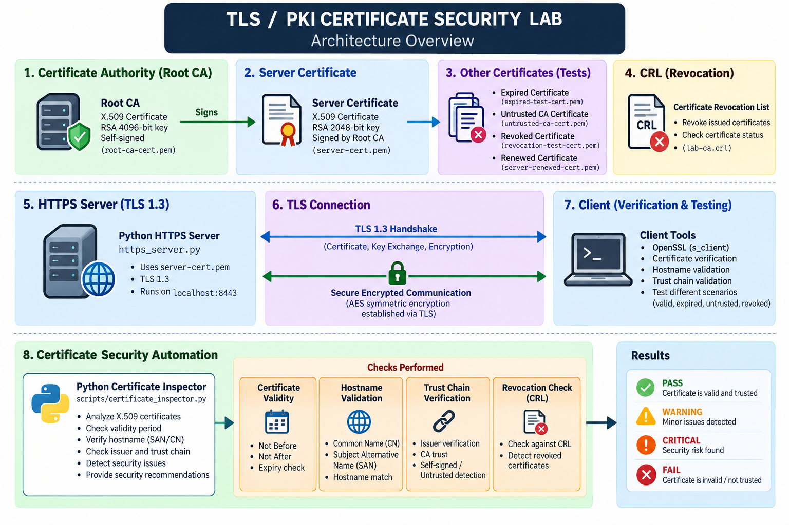

# TLS, PKI & Certificate Management Security Lab

A hands-on cybersecurity lab focused on **TLS, Public Key Infrastructure (PKI), X.509 certificates, cryptography, certificate lifecycle management, and security automation**.

The project was built from the ground up using OpenSSL, Python, and a local HTTPS environment to understand how certificates are created, trusted, validated, renewed, revoked, and monitored.

---

## Project Overview

This lab simulates a small certificate management and TLS environment.

The project covers:

- Cryptographic fundamentals
- Symmetric and asymmetric encryption
- SHA-256 hashing
- RSA digital signatures
- Public Key Infrastructure (PKI)
- Root Certificate Authority (CA)
- X.509 certificates
- Certificate Signing Requests (CSR)
- Certificate validation
- Certificate expiry monitoring
- Certificate renewal
- Certificate revocation using CRL
- TLS 1.3
- HTTPS
- Hostname / SAN validation
- Certificate trust verification
- Security failure testing
- Python-based certificate security automation

---

## Objectives

The main objectives of this project were to:

1. Understand the fundamentals of cryptography used by TLS.
2. Build a local Public Key Infrastructure.
3. Create a Root Certificate Authority.
4. Generate server keys and CSRs.
5. Issue and validate X.509 certificates.
6. Configure a local HTTPS server using TLS.
7. Investigate certificate validation failures.
8. Demonstrate certificate renewal and revocation.
9. Automate certificate security checks using Python.
10. Produce a reusable certificate security assessment tool.

---

## Architecture



The lab consists of:

```text
Root CA
   |
   | signs
   v
Server X.509 Certificate
   |
   v
Python HTTPS Server
   |
   | TLS 1.3
   v
Client / OpenSSL

                |
                v
      Python Certificate Inspector
                |
        Security Checks
                |
       PASS / WARNING /
       CRITICAL / FAIL
```

---

## Technologies Used

| Technology | Purpose |
|---|---|
| OpenSSL | Cryptography, PKI and certificate operations |
| Python 3 | Security automation |
| Python cryptography | X.509 certificate inspection |
| TLS 1.3 | Secure communication |
| HTTPS | Encrypted application communication |
| RSA | Asymmetric cryptography and signatures |
| AES | Symmetric encryption |
| SHA-256 | Cryptographic hashing |
| X.509 | Certificate standard |
| CRL | Certificate revocation |
| Git | Version control |

---

# 1. Cryptography Fundamentals

Before implementing PKI, the fundamental cryptographic mechanisms used in secure communication were tested.

## SHA-256

SHA-256 was used to demonstrate data integrity.

Changing a single character in the input produced a completely different hash.

```text
Original message
       |
       v
    SHA-256
       |
       v
  Hash value

Modified message
       |
       v
    SHA-256
       |
       v
Different hash
```

### Security property

**Integrity**

---

## AES

AES-256-CBC was used to demonstrate symmetric encryption.

The same secret key is used for encryption and decryption.

```text
Plaintext
    |
    | AES encryption
    v
Ciphertext
    |
    | AES decryption
    v
Plaintext
```

### Security property

**Confidentiality**

> Note: AES-CBC by itself does not provide authenticated encryption. Modern applications commonly use authenticated encryption modes such as AES-GCM.

---

## RSA

RSA was used to demonstrate asymmetric cryptography.

A key pair was generated:

```text
RSA Private Key
      |
      | derives
      v
RSA Public Key
```

The public key can be shared while the private key must remain protected.

RSA was used for:

- Encryption/decryption demonstration
- Digital signatures
- Certificate public-key infrastructure

---

## Digital Signatures

A message was signed using the RSA private key and verified using the corresponding public key.

```text
Message
   |
   | SHA-256 + RSA private key
   v
Digital Signature
   |
   | verify using public key
   v
Valid / Invalid
```

Digital signatures provide:

- Integrity
- Authenticity

---

# 2. Public Key Infrastructure

A local PKI environment was created using OpenSSL.

## Root Certificate Authority

A self-signed Root CA was created using a 4096-bit RSA key.

The Root CA was configured with:

```text
CA:TRUE
Certificate Sign
CRL Sign
```

The Root CA acts as the trust anchor for the lab.

```text
TLS Lab Root CA
RSA 4096
     |
     | signs
     v
Server Certificate
RSA 2048
```

---

# 3. Server Certificate

A separate 2048-bit RSA private key was generated for the HTTPS server.

A Certificate Signing Request (CSR) was then created.

The CSR contained:

- Subject information
- Server public key
- Subject Alternative Name

The server certificate was issued by the lab Root CA.

---

## Certificate Extensions

The server certificate contains:

```text
Basic Constraints:
CA:FALSE

Key Usage:
Digital Signature
Key Encipherment

Extended Key Usage:
TLS Web Server Authentication

Subject Alternative Name:
DNS:localhost
IP:127.0.0.1
```

These extensions restrict how the certificate is intended to be used.

---

# 4. Certificate Validation

The issued server certificate was validated against the Root CA.

The following checks were performed:

- Certificate signature
- Certificate chain/trust
- Validity period
- Hostname
- SAN
- Basic Constraints
- Key Usage
- Extended Key Usage
- Public-key strength

---

# 5. TLS 1.3 HTTPS Server

A Python HTTPS server was created using:

```text
https_server.py
```

The server uses the generated X.509 certificate and private key.

The service runs locally on:

```text
https://localhost:8443
```

TLS negotiation was tested using OpenSSL.

The lab successfully established:

```text
Protocol:
TLSv1.3

Cipher:
TLS_AES_256_GCM_SHA384

Server key exchange:
X25519

Certificate signature:
RSA-PSS
```

Certificate verification succeeded when the lab Root CA was explicitly trusted and the hostname matched.

---

# 6. Certificate Security Failure Testing

A major part of the lab was deliberately creating invalid or untrusted certificate scenarios.

## Hostname mismatch

The valid server certificate was tested against an incorrect hostname.

Expected result:

```text
Hostname Check: FAIL
```

This demonstrates why hostname validation is an important part of TLS certificate verification.

---

## Untrusted CA

The server certificate was tested without trusting the lab Root CA.

The TLS verification process reported an inability to establish a trusted issuer.

This demonstrates that:

> A certificate being correctly formatted does not automatically make it trusted.

---

## Expired Certificate

A test certificate with an expired validity period was created.

Certificate verification failed because the certificate had expired.

---

## Untrusted Test CA

A separate test CA was created.

A valid-looking server certificate was signed by this untrusted CA.

The Python inspector detected:

```text
Issuer Check: FAIL
Signature Verification: FAIL
Certificate Status: FAIL
```

This demonstrates the difference between:

- Certificate structure
- Issuer identity
- Cryptographic trust

---

# 7. Certificate Renewal

A replacement server certificate was generated to simulate certificate renewal.

The renewed certificate was:

- Newly generated
- Signed by the trusted Root CA
- Valid for the configured lifetime
- Successfully verified

Certificate renewal is an important operational control because expired certificates can cause service outages and security failures.

---

# 8. Certificate Revocation

A Certificate Revocation List (CRL) was implemented using OpenSSL.

A test certificate was:

1. Issued
2. Added to the CA database
3. Revoked
4. Included in the CRL
5. Tested using CRL-based verification

The revoked certificate produced:

```text
certificate revoked
```

This demonstrates how a CA can communicate that a previously issued certificate should no longer be trusted.

---

# 9. Certificate Security Automation

A Python security inspection tool was developed:

```text
scripts/certificate_inspector.py
```

The tool uses the Python `cryptography` library to inspect X.509 certificates.

## Automated checks

The inspector currently performs:

### Certificate validity

Checks whether the certificate:

- Has expired
- Expires within 7 days
- Expires within 30 days
- Has sufficient remaining validity

Severity:

```text
> 30 days    PASS
8–30 days    WARNING
1–7 days     CRITICAL
< 0 days     FAIL
```

### Hostname / SAN

Checks whether the expected hostname or IP address is present in the certificate's Subject Alternative Name extension.

### Issuer

Checks whether the certificate issuer matches the expected CA.

### Cryptographic trust

The certificate signature is verified using the trusted CA public key.

### Basic Constraints

Checks that a server certificate is correctly marked:

```text
CA:FALSE
```

### Key Usage

Checks:

```text
Digital Signature
Key Encipherment
```

### Extended Key Usage

Checks for:

```text
TLS Web Server Authentication
```

### RSA key strength

The tool checks that RSA certificates meet the configured minimum:

```text
Minimum RSA key size: 2048 bits
```

---

# 10. Security Assessment

The Python tool produces an overall security assessment:

```text
PASS
WARNING
CRITICAL
FAIL
```

Example successful assessment:

```text
Failed Checks : 0
Critical Issues: 0
Warnings      : 0
Certificate Status: PASS
```

Example expired certificate:

```text
Failed Checks : 1
Certificate Status: FAIL
```

Example untrusted certificate:

```text
Failed Checks : 2
Certificate Status: FAIL
```

---

# 11. Security Testing Summary

| Scenario | Expected Result | Result |
|---|---|---|
| Valid certificate | PASS | PASS |
| Expired certificate | FAIL | FAIL |
| Hostname mismatch | FAIL | FAIL |
| Untrusted CA | FAIL | FAIL |
| Invalid trust signature | FAIL | FAIL |
| Valid RSA 2048 key | PASS | PASS |
| CA:FALSE server certificate | PASS | PASS |
| TLS server authentication | PASS | PASS |
| Certificate renewal | PASS | PASS |
| Revoked certificate | FAIL | FAIL |

---

# 12. Evidence

The `evidence/` directory contains screenshots demonstrating the practical work performed throughout the lab.

Examples include:

- SHA-256 integrity testing
- AES encryption/decryption
- RSA encryption/decryption
- Digital signature verification
- Root CA creation
- Certificate generation
- Certificate validation
- TLS 1.3 handshake
- Hostname mismatch
- Untrusted CA
- Certificate expiry
- Certificate renewal
- Certificate revocation
- Python certificate inspection
- Cryptographic CA verification
- Untrusted CA detection

---

# 13. Project Structure

```text
TLS-PKI-Certificate-Security-Lab/
│
├── README.md
├── .gitignore
│
├── fundamentals/
│   ├── rsa-public.pem
│   ├── rsa-message.txt
│   ├── rsa-message.enc
│   ├── rsa-message.sig
│   └── secret.txt.enc
│
├── pki/
│   ├── ca/
│   │   └── root-ca-cert.pem
│   │
│   ├── server/
│   │   ├── server-cert.pem
│   │   ├── server-cert-ext.cnf
│   │   └── renewal/
│   │
│   ├── crl-demo/
│   │   ├── lab-ca.crl
│   │   ├── openssl-ca.cnf
│   │   └── revocation-test-cert.pem
│   │
│   └── tests/
│       ├── expired-test-cert.pem
│       └── untrusted/
│
├── scripts/
│   └── certificate_inspector.py
│
├── docs/
│   └── architecture.png
│
└── evidence/
    └── security test screenshots
```

---

# 14. Security Considerations

Private keys are intentionally excluded from this repository.

The following types of sensitive material must never be committed:

```text
*-private.pem
*.key
*.p12
*.pfx
```

The `.gitignore` file is used to prevent accidental inclusion of private cryptographic material.

In a production PKI environment, additional controls would be required, including:

- Hardware Security Modules (HSM)
- Offline Root CA
- Intermediate CA architecture
- Strong private-key protection
- Certificate inventory
- Automated renewal
- OCSP
- CRL distribution
- Centralized monitoring
- Access control
- Audit logging

---

# 15. Limitations

This project is a local educational security lab and does not represent a production PKI deployment.

The following simplifications were made:

- A single Root CA directly signs the server certificate.
- The lab does not use an Intermediate CA.
- Certificate trust verification is implemented specifically for the lab's RSA CA.
- The Python inspector does not implement a complete general-purpose X.509 path-building engine.
- Revocation testing uses CRL rather than a production OCSP infrastructure.
- The HTTPS server is local and intended for experimentation.

These limitations are intentional so that the underlying security mechanisms can be understood step-by-step.

---

# 16. Key Lessons Learned

This project demonstrated several important security principles:

### 1. Encryption is not the same as hashing

Encryption protects confidentiality, while hashing is primarily used for integrity and fingerprinting.

### 2. Digital signatures are different from encryption

Digital signatures provide integrity and authenticity using asymmetric cryptography.

### 3. Certificates bind identity to public keys

A certificate allows a client to associate a public key with an identity through a trusted CA.

### 4. Trust is more than an issuer name

A certificate can contain a legitimate-looking issuer name but still fail cryptographic verification.

### 5. Hostname validation matters

A trusted certificate can still be rejected if it is not valid for the requested hostname.

### 6. Certificate lifecycle management is important

Certificates must be:

```text
Issued
   ↓
Validated
   ↓
Monitored
   ↓
Renewed
   ↓
Revoked when necessary
```

### 7. Automation reduces manual security checks

The Python inspector demonstrates how certificate validation can be automated and integrated into security monitoring workflows.

---

# 17. Future Improvements

Possible future enhancements include:

- Intermediate CA support
- Full certificate-chain validation
- OCSP checking
- Automated certificate inventory
- JSON output
- CSV reporting
- Email/security alerts
- Directory-wide certificate scanning
- Automated renewal detection
- Integration with SIEM platforms
- Certificate monitoring dashboards
- CI/CD certificate security checks

---

## Conclusion

This project provided a hands-on implementation of the cryptographic and certificate-management mechanisms underlying TLS.

The lab progressed from basic cryptography to PKI, certificate issuance, TLS 1.3 communication, certificate lifecycle management, security failure testing, and Python-based certificate security automation.

The final result is a reproducible local environment that demonstrates both **technical understanding and practical security validation** of TLS certificates.

```text
Cryptography
     ↓
PKI
     ↓
X.509 Certificates
     ↓
TLS 1.3
     ↓
Certificate Lifecycle
     ↓
Security Testing
     ↓
Security Automation
```
